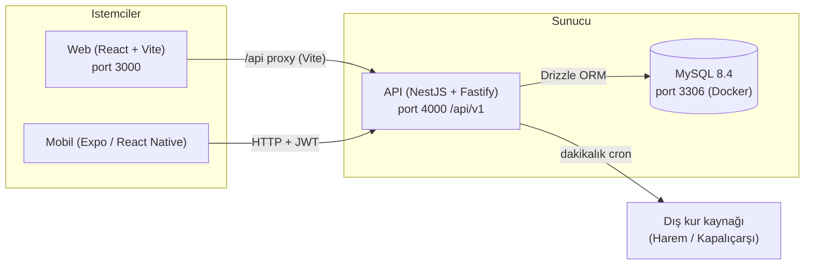
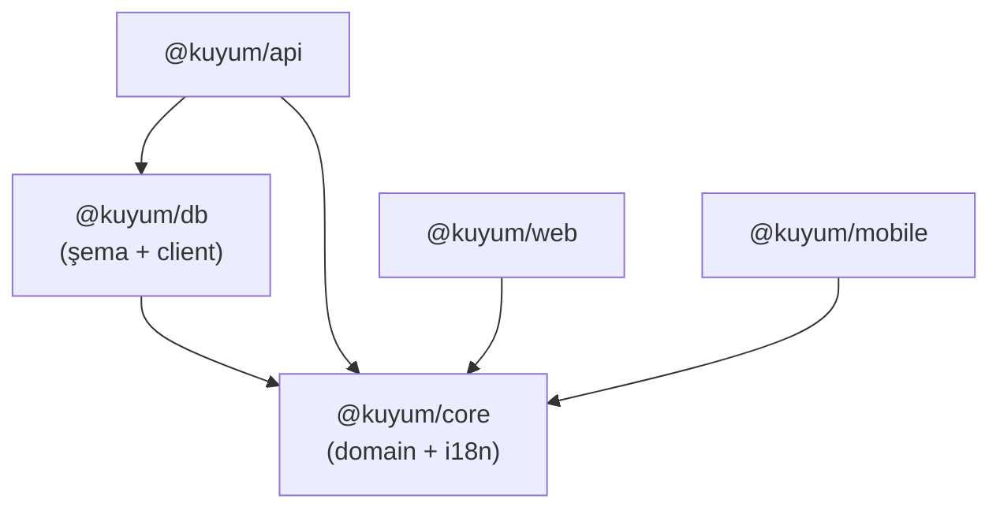
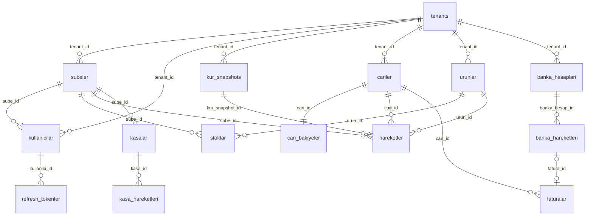
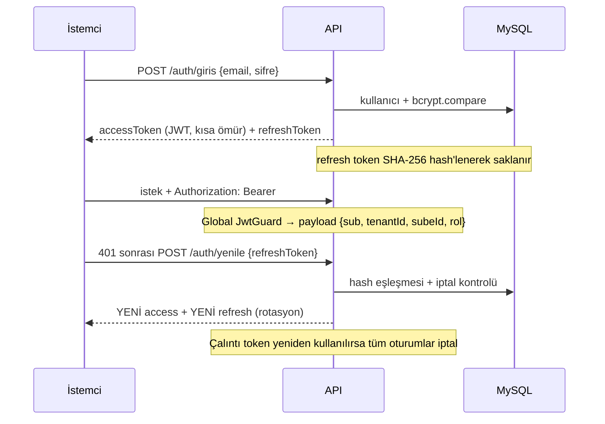
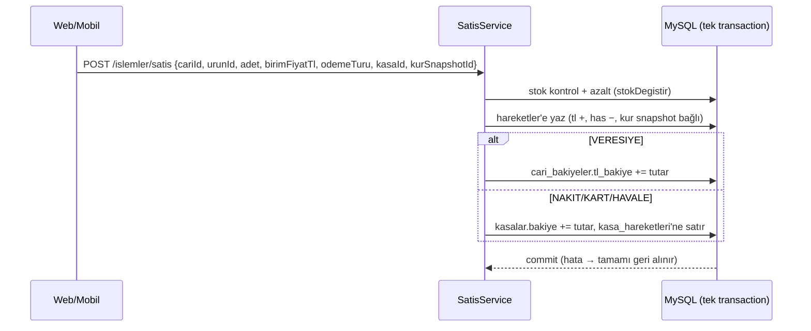

# Kuyumcu ERP — Mimari Dokümanı

Kuyumcu işletmeleri için çok kiracılı (multi-tenant) ERP. SaaS öncelikli tasarlandı;
aynı kod tabanı on-prem (işletme içi) kuruluma da uygundur.

---

## 1. Genel Bakış



| Katman | Teknoloji | Neden |
|---|---|---|
| Monorepo | **pnpm workspaces + Turborepo** | Paylaşılan paketler (`core`, `db`) tek repo içinde sürümsüz paylaşılır |
| Backend | **NestJS 11 + Fastify** | Modüler DI mimarisi, Fastify ile düşük gecikme |
| ORM | **Drizzle ORM** | Tip güvenli SQL, hafif migration akışı |
| Veritabanı | **MySQL 8.4** | Yaygınlık, on-prem kolaylığı; `utf8mb4_turkish_ci` |
| Web | **React 19 + Vite 6 + Tailwind v4** | Hızlı geliştirme, CSS-first tema |
| Mobil | **Expo SDK 53 + Expo Router 4** | Dosya tabanlı navigasyon, tek kod iOS/Android |
| Durum | **Zustand 5** (persist) + **TanStack Query 5** | İstemci durumu / sunucu durumu ayrımı |
| Kimlik | **JWT (access) + rotasyonlu refresh token** | Stateless doğrulama + çalıntı token tespiti |

### Depo yerleşimi

```
kuyumcu/
├─ apps/
│  ├─ api/        NestJS REST API
│  ├─ web/        React SPA
│  └─ mobile/     Expo uygulaması
├─ packages/
│  ├─ core/       Saf domain mantığı + i18n sözlükleri (bağımsız TS)
│  └─ db/         Drizzle şemaları + migration'lar + DB istemcisi
├─ scripts/       seed.mjs, devir.mjs (test verisi)
├─ docs/          KULLANIM_KILAVUZU.md, A11Y_RAPORU.md, bu doküman
├─ docker-compose.yml   MySQL servisi
└─ start.bat / stop.bat Tek tık çalıştırma
```

**Bağımlılık yönü** (tersine akış yok):



`core` hiçbir şeye bağımlı değildir; web/mobil **veritabanına asla doğrudan erişmez**.

---

## 2. `@kuyum/core` — Domain Çekirdeği

Çerçevesiz, saf TypeScript. İki sorumluluğu var:

### 2.1 Domain hesapları (`src/domain/`)
| Dosya | İçerik |
|---|---|
| `metal.ts` | `ALTIN_AYARLARI` (K8–K24), `GUMUS_AYARLARI` (G800–G950), milyem değerleri |
| `has.ts` | **Branded type**'lar: `HasGram`, `GramWeight`; `toHasGram(gram, ayar)` çevirimi |
| `kur.ts` | Kur hesap yardımcıları |
| `cari.ts`, `urun.ts`, `hareket.ts` | Domain tip tanımları |

**Has gram** sistemin ortak para birimidir: `(gramAğırlık − taşAğırlık) × milyem / 1000`
→ her ürün 24K saf altın karşılığına normalize edilir. Branded type'lar sayesinde
çıplak `number` ile has gram derleme anında karışamaz.

### 2.2 Çeviri sözlükleri (`src/i18n/`)
`tr.ts` ana sözlük, `en.ts` ise `Sozluk` tipiyle **birebir aynı anahtarlara zorlanır**
— bir anahtar eksikse derleme hatası. Web ve mobil aynı sözlükleri tüketir.

> Not: `core` CommonJS derlenir; `exports` alanında `import`/`require` koşulları
> birlikte tanımlıdır (Vite + Node + Metro uyumu). Web tarafında
> `optimizeDeps.include` ile ön-paketlenir.

---

## 3. `@kuyum/db` — Veri Katmanı

Drizzle ORM şemaları + `drizzle-kit` migration'ları. **15 tablo**, tamamı ULID
birincil anahtarlı (`varchar(36)`), finansal alanlar `decimal` (float asla).

### 3.1 Varlık ilişki şeması



### 3.2 Tablo özetleri

| Tablo | Rolü | Kritik alanlar |
|---|---|---|
| `tenants` | Kiracı (işletme) | `plan` (BASLANGIC/PRO/KURUMSAL), `ai_etkin` |
| `subeler` | Şubeler | tenant'a bağlı |
| `kullanicilar` | Kullanıcılar | `rol` enum, `sifre_hash` (bcrypt), **`(email, tenant_id)` bileşik unique** |
| `refresh_tokenler` | Oturumlar | `token_hash` (SHA-256), `iptal_edildi`, IP + user-agent |
| `kur_snapshots` | Kur anları | `altin_has_fiyati`, kaynak (HAREM/…/MANUAL) — her işlem birine bağlanır |
| `cariler` | Müşteri/tedarikçi/atölye/sarraf | `kredi_limiti_tl` |
| `cari_bakiyeler` | Cari bakiye özeti | `tl_bakiye` + `has_gram_bakiye` (paralel defter) |
| `urunler` | Ürün kartları | `milyem`, `has_grami` (**hesaplanır, elle girilmez**), barkod/RFID |
| `stoklar` | Şube×ürün stok | `adet`, `toplam_has_gram` |
| `hareketler` | **Ana defter (append-only)** | `tl_tutari` + `has_grami` çifti, `kur_snapshot_id`, `kullanici_id` (denetim izi) |
| `kasalar` / `kasa_hareketleri` | Nakit/POS kasaları | bakiye + hareket günlüğü, komisyon/blokaj alanları |
| `banka_hesaplari` / `banka_hareketleri` | IBAN bazlı hesaplar | hareket durumu: `BEKLIYOR → ESLESTI → FATURALANDI` |
| `faturalar` | Faturalar | `FTR-<yıl>-<sıra>` no, KDV ayrıştırması, `banka_hareket_id` bağlantısı |

### 3.3 Tasarım kuralları

- **Paralel defter:** `hareketler` her satırda hem `tl_tutari` hem `has_grami` taşır.
  İşaret kuralı: satışta TL **+** (kasaya girer) / has **−** (stoktan çıkar); alışta tersi.
- **Append-only:** `hareketler`, `kasa_hareketleri`, `kur_snapshots`, `refresh_tokenler`
  güncellenmez — düzeltme ters kayıtla yapılır (denetim izi).
- **Bakiye özet tabloları** (`cari_bakiyeler`, `kasalar.bakiye`, `banka_hesaplari.bakiye`)
  hareketle **aynı transaction içinde** güncellenir; rapor sorguları O(1) kalır.
- **Migration akışı:** şema değişir → `pnpm db:generate` (SQL üretir, `drizzle/000N_*.sql`)
  → `pnpm db:migrate` (uygular). Migration dosyaları repo'da versiyonlanır.

---

## 4. `apps/api` — Backend (NestJS + Fastify)

### 4.1 Başlatma hattı (`main.ts`)
- Fastify adapter (dev'de istek logları açık)
- Global `ValidationPipe({ whitelist, transform, forbidNonWhitelisted })`
  → DTO'da olmayan alan **400 döner** (sözleşme sıkı)
- Global prefix: **`/api/v1`**, CORS açık, `PORT` (varsayılan 4000 — `.env`)

### 4.2 Modül haritası

```
src/
├─ common/db/        DbModule — Drizzle client'ı DI token'ı (DB) olarak sağlar
└─ modules/
   ├─ auth/          kayıt (bootstrap), giriş, refresh rotasyonu, guards, dekoratörler
   ├─ kullanici/     kullanıcı CRUD, şifre değiştirme
   ├─ kur/           güncel/geçmiş kur, manuel giriş, cron scheduler (dakikalık çekim,
   │                 90 günden eski snapshot temizliği)
   ├─ cari/          cari CRUD + bakiyeli liste, ekstre, veresiye/tahsilat
   ├─ urun/          ürün CRUD (has gram otomatik hesap + stok cascade), barkod arama
   ├─ satis/         SATIŞ / ALIŞ / HURDA_ALIŞ / TRANSFER / TAKAS / İŞÇİLİK
   ├─ kasa/          kasa CRUD, GIRIS/CIKIS hareketleri, komisyon
   ├─ emanet/        müşteri altını emanet giriş/çıkış (has gram)
   ├─ banka/         hesap CRUD, dekont, GELEN hareketi faturaya dönüştürme
   ├─ fatura/        fatura CRUD, durum makinesi (TASLAK→KESILDI→ODENDI / IPTAL)
   ├─ rapor/         günlük/aylık özet, cari yaşlandırma, stok değeri
   ├─ sube/          şube CRUD
   └─ admin/         tenant planı, AI toggle (SAHIP)
```

### 4.3 Kimlik doğrulama ve yetkilendirme



- **Global guard'lar** (`APP_GUARD`): `JwtGuard` + `RolesGuard` — her endpoint
  varsayılan korumalı; `@HerkesGirebilir()` yalnızca kayıt/giriş/yenilemeyi açar.
- **Rol hiyerarşisi:** `SAHIP(4) > MUDUR(3) > MUHASEBE(2) > TEZGAHTAR(1)`,
  `@Roles(...)` dekoratörüyle uç bazında.
- **Bootstrap:** `POST /auth/kayit` tek transaction'da tenant + Merkez Şube +
  SAHIP kullanıcı oluşturur (ilk kullanıcı sorunu).
- **Giriş:** tenantId opsiyonel — e-posta tek tenant'ta ise yeterli; birden çok
  tenant'ta kayıtlıysa tenantId istenir.

### 4.4 Multi-tenancy

Her tabloda `tenant_id`; her servis sorgusu JWT'den gelen `islem.tenantId` ile
filtrelenir (satır seviyesi izolasyon). Tenant'lar arası veri sızıntısı, servis
katmanındaki `tenantXBul(id, tenantId)` yardımcıları ile engellenir.

### 4.5 İşlem deseni — örnek: satış



Tüm çok tablolu işlemler `this.db.transaction(async (tx) => …)` içinde;
`stokDegistir`, `cariBakiyeGuncelle`, `kasaGuncelle` yardımcıları satış/alış/
hurda/takas/transfer arasında paylaşılır. **Her parasal işlem `kurSnapshotId`
ister** — tutarlar hangi kur anında oluştuğunu kalıcı olarak bilir.

---

## 5. `apps/web` — Web İstemcisi

### 5.1 Yapı

```
src/
├─ main.tsx            React 19 + QueryClientProvider
├─ App.tsx             Router + auth guard (token yoksa /giris) + profil geri yükleme
├─ app.css             Tailwind v4 (@theme ile altın paleti)
├─ api/                Axios katmanı — client.ts + modül başına dosya
├─ store/              auth.store.ts, dil.store.ts (Zustand + localStorage persist)
├─ components/
│  ├─ ui/index.tsx     Button, Input, Select, Modal, Badge, alerts… (erişilebilir)
│  ├─ layout/          Sidebar, Header (canlı kur), AppLayout
│  └─ shared/          DilSecici
└─ pages/              Login, Dashboard, Cari, Urun, Satis, Kasa, Banka, Fatura, Rapor, Ayarlar
```

### 5.2 Veri akışı ve durum

- **Sunucu durumu:** TanStack Query (`staleTime` 30 sn; kur 60 sn'de bir yenilenir).
  Mutasyon sonrası `invalidateQueries` ile ilgili listeler tazelenir.
- **İstemci durumu:** Zustand.
  - `auth.store` — yalnızca token'lar persist edilir (`partialize`); kullanıcı
    profili sayfa yenilemede `/auth/ben` ile geri yüklenir.
  - `dil.store` — dil seçimi persist + `document.documentElement.lang` senkronu
    (CSS `uppercase` Türkçe i→İ kuralı için).
- **API katmanı** (`api/client.ts`): baseURL `/api/v1` (Vite proxy → 4000).
  İstek interceptor'ı Bearer ekler; 401'de refresh → isteği yineler → olmazsa çıkış.
  Liste uçları çıplak dizi döner; API katmanı `{ cariler }/{ urunler }/{ kasalar }`
  şekline **normalize eder** ve sayfa parametrelerini API adlarına çevirir
  (`arama→q`, `ayar→ayarId`).
- **Erişilebilirlik:** paylaşılan bileşenlerde WCAG 2.1 AA düzeltmeleri gömülü
  (dialog semantiği + focus trap + Escape, label-input bağı, `role="alert/status"`,
  AA kontrast paleti). Ayrıntı: `docs/A11Y_RAPORU.md`.

---

## 6. `apps/mobile` — Mobil İstemci (Expo)

```
app/                        Expo Router (dosya tabanlı)
├─ _layout.tsx              QueryClient + AuthGuard (segment bazlı yönlendirme)
├─ (auth)/giris.tsx         Giriş / İşletme Kur
└─ (tabs)/                  Alt sekme çubuğu
   ├─ index.tsx  cariler.tsx  islemler.tsx  kasalar.tsx  raporlar.tsx
src/
├─ api/                     Web ile aynı sözleşme; baseURL http://localhost:4000/api/v1
├─ store/                   auth (AsyncStorage persist), dil
├─ components/ui.tsx        Btn, Field, Card, Chip… (accessibilityRole/State'li)
└─ theme.ts                 Renk/spacing sabitleri (AA kontrast tonları dahil)
```

Web ile aynı `@kuyum/core` sözlükleri ve aynı API sözleşmesi kullanılır; fark
yalnızca görsel katmandır (StyleSheet vs Tailwind). Banka/Fatura modülleri şimdilik
yalnızca web'dedir.

---

## 7. Çapraz Kesen Konular

### Güvenlik
| Konu | Uygulama |
|---|---|
| Parola | bcrypt hash |
| Refresh token | SHA-256 hash ile saklanır, rotasyon + yeniden kullanım tespiti |
| Girdi doğrulama | class-validator DTO + `forbidNonWhitelisted` |
| Yetki | Global guard + rol dekoratörleri, servis katmanında tenant filtresi |
| Gizli değerler | `apps/api/.env` (repo dışı); `JWT_SECRET`, `DATABASE_URL` |

### Uluslararasılaştırma
Tek kaynak `@kuyum/core/i18n` — TR ana, EN tip-zorunlu ayna. Tarih/para
biçimlemesi `Intl` ile locale'e göre.

### Hata modeli
API `{ statusCode, message, error }` (Nest standardı) döner; istemciler
`response.data.message`'ı gösterir, yoksa çeviriden genel mesaj.

---

## 8. Çalıştırma ve Dağıtım

### Geliştirme (tek tık)
`start.bat`: pnpm kontrol → bağımlılık kurulumu → `.env` yoksa örnekten kopya →
`docker compose up -d mysql` + healthcheck bekleme → API (4000) ve Web (3000)
ayrı pencerelerde → tarayıcı açılır. `stop.bat` portlardan PID bulup süreç
ağacını kapatır (MySQL veri güvenliği için açık kalır).

### Test verisi
`node scripts/seed.mjs` — API üzerinden 100+ gerçekçi kayıt (cari, ürün, alış/satış,
hurda, işçilik, emanet, banka, fatura). Tekrar çalıştırılabilir (409'ları atlar).
`node scripts/devir.mjs` — kasa/banka açılış bakiyeleri.

### Üretim hedefi
- **SaaS:** tek API + tek MySQL, tenant bazlı satır izolasyonu (mevcut tasarım).
- **On-prem:** aynı docker-compose genişletilerek API+Web konteynerleri eklenir
  (yol haritasında).

---

## 9. Önemli Mimari Kararlar (özet ADR)

| # | Karar | Gerekçe |
|---|---|---|
| 1 | ULID birincil anahtar | Sıralanabilir, çakışmasız, offline üretilebilir |
| 2 | `decimal` + string taşıma | Kayan nokta hatası finansta kabul edilemez; JS tarafında `parseFloat` yalnızca gösterimde |
| 3 | Paralel defter (TL + has) | Altın fiyatı oynak; gerçek varlık has gramla ölçülür |
| 4 | Append-only hareketler | Denetim izi; düzeltme ters kayıtla |
| 5 | Kur snapshot zorunluluğu | Her işlem, anındaki kura kalıcı bağlanır |
| 6 | Bakiye özet tabloları | Rapor sorgularını hareket taramasından kurtarır |
| 7 | Global guard + opt-out | Endpoint korumasını unutmak imkânsız |
| 8 | Sözlükler `core`'da tip-zorunlu | Çeviri eksikleri derlemede yakalanır |
| 9 | Liste normalize katmanı (istemci) | API dizi döner; UI sözleşmesi tek noktada eşlenir |

---
*Bu doküman v0.1 kod tabanını yansıtır (15 tablo, 14 API modülü, 10 web sayfası,
6 mobil ekran). Yol haritası: e-Fatura entegrasyonu, açık bankacılık, Docker ile
tam on-prem paket, TAKAS ekranı.*
